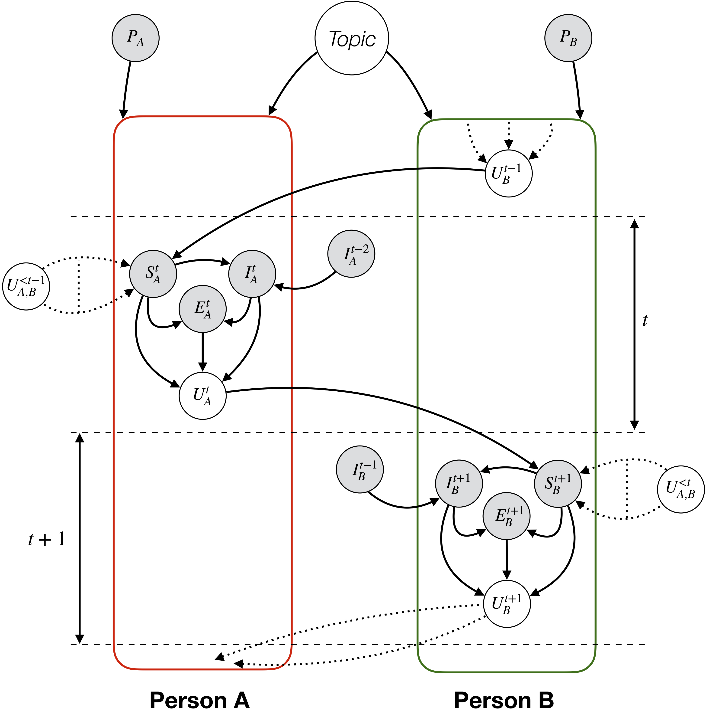
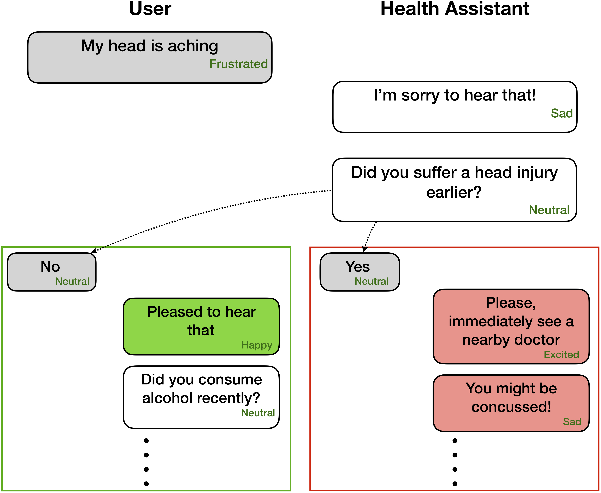
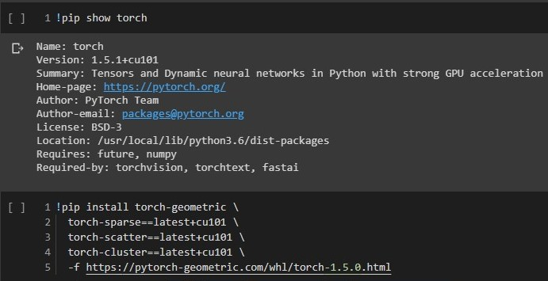

# Emotion Recognition in Conversations

This repository contains implementations for conversational emotion detection methods, namely:

- [Emotion Recognition in Conversations](#emotion-recognition-in-conversations)
  * [Data Format](#data-format)
  * [DialogueGCN (PyTorch)](#dialoguegcn-a-graph-convolutional-neural-network-for-emotion-recognition-in-conversation)


Unlike other emotion detection models, these techniques consider the party-states and inter-party dependencies for modeling conversational context relevant to emotion recognition. The primary purpose of all these techniques are to pretrain an emotion detection model for empathetic dialogue generation.

<p align="center">
  
  <figcaption stype="display:table-caption;"><em>Fig. 1: Interaction among different controlling variables during a
dyadic conversation between persons A and B. Grey and white circles
represent hidden and observed variables, respectively. P represents
personality, U represents utterance, S represents interlocutor state, I
represents interlocutor intent, E represents emotion and Topic represents
topic of the conversation. This can easily be extended to multi-party
      conversations.</em></figcaption>
</p>


Emotion recognition can be very useful for empathetic and affective dialogue generation - 

<p align="center">
  
</p>


## Data Format

These networks expect emotion/sentiment label and speaker info for each utterance present in a dialogue like
```
Party 1: I hate my girlfriend (angry)
Party 2: you got a girlfriend?! (surprise)
Party 1: yes (angry)
```
However, the code can be adpated to perform tasks where only the preceding utterances are available, without their corresponding labels, as context and goal is to label only the present/target utterance. For example, the *context* is
```
Party 1: I hate my girlfriend
Party 2: you got a girlfriend?!
```
the *target* is
```
Party 1: yes (angry)
```
where the target emotion is _angry_.
Moreover, this code can also be molded to train the network in an end-to-end manner. We will soon push these useful changes. 


## DialogueGCN: A Graph Convolutional Neural Network for Emotion Recognition in Conversation

[_DialogueGCN_](https://arxiv.org/pdf/1908.11540.pdf) (Dialogue Graph Convolutional Network), is a graph neural network based approach to ERC. We leverage self and inter-speaker dependency of the interlocutors to model conversational context for emotion recognition. Through the graph network, DialogueGCN addresses context propagation issues present in the current RNN-based methods. DialogueGCN is naturally suited for multi-party dialogues.


### Requirements

- Python 3
- PyTorch 1.5
- PyTorch Geometric 1.5
- Pandas
- Scikit-Learn
- TensorFlow (optional; required for tensorboard)
- tensorboardX (optional; required for tensorboard)

### Dataset

- [DailyDialog](https://drive.google.com/file/d/13rHLtAMmDsiCP1hZwWqMNcrtkmZF_hK3/view?usp=sharing)

### Version Check

<p align="center">
  
  <figcaption stype="display:table-caption;"><em>Fig. 3: PyTorch+cuda And Torch-Geometric+cuda Version</em></figcaption>
</p>

__Note__: Before training make sure Pytorch+cuda and Torch-Geometric+cuda version matches, especially cuda version as shown in figure 3.

### Execution

__Note__: PyTorch Geometric makes heavy usage of CUDA atomic operations and is a source of non-determinism. To reproduce the results reported in the paper, we recommend to use the following execution command. Note that this script will execute in CPU. We obatined weighted average F1 scores of 64.67 in our machine and 64.44 in Google colaboratory for IEMOCAP dataset with the following command.

1.__Base Models__:
- DialogRNN
- LSTM
- GRU

2. _DaiilyDialog_ dataset: `python train_DailyDialogue.py --base-model 'GRU' --graph-model --lr 0.003 --batch-size 32 --class-weight`

### Command-Line Arguments

-  `--no-cuda`: Does not use GPU
-  `--base-model`: Base model
-  `--lr`: Learning rate
-  `--l2`: L2 regularization weight
-  `--windowp`: Window size for past node
-  `--windowf`: Window size for future node
-  `--rec-dropout`: Recurrent dropout
-  `--dropout`: Dropout
-  `--batch-size`: Batch size
-  `--epochs`: Number of epochs
-  `--graph-model`: GCN model
-  `--class-weight`: Class weight (not applicable for AVEC)
-  `--active-listener`: Explicit lisnener mode
-  `--nodal-attention`: Use of nodal attention in GCN
-  `--attention`: Attention type
-  `--tensorboard`: Enables tensorboard log

### Inference

__Note__: To make a prediction, make sure the test data is in the same format as provided in dailydialog/inference_sample.json file. If file path is not provided, it will use inference_sample.json file as default data file.

1. _DaiilyDialog_ dataset: `python inference_DailyDialogue.py --inference-file path/to/your/file.json --model-weights checkpoints/DailyDialog/GraphGRU.pt --show-result --no-cuda`

### Command-Line Arguments

-  `--no-cuda`: Does not use GPU
-  `--tokenizer`: Pre-fitted tokenizer on train data
-  `--inference-file`: Test data json file
-  `--model-weights`: Path trained model weights
-  `--sstatistics`: Show accuracy, fscore, precision, recall for test data
-  `--show-result`: Show sentence-true label-predicted label for all utterances in data 

### Citation

Please cite the following paper if you find this code useful in your work.

`DialogueGCN: A Graph Convolutional Neural Network for Emotion Recognition in Conversation. D. Ghosal, N. Majumder, S. Poria, N. Chhaya, & A. Gelbukh. EMNLP-IJCNLP (2019), Hong Kong, China.`


